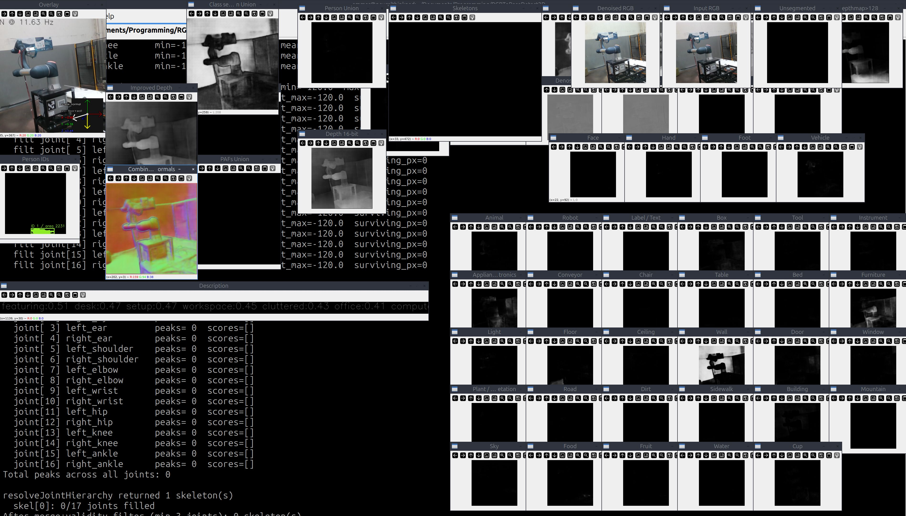
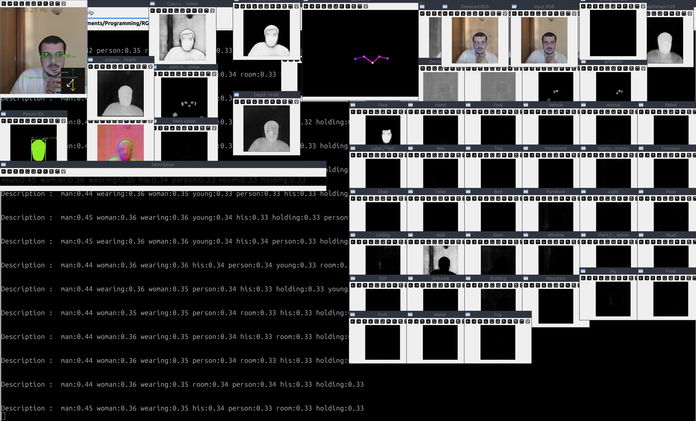
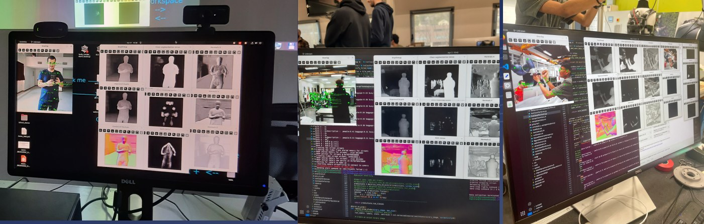

# Magician Project — General Visual Perception

[](https://colab.research.google.com/github/FORTH-ICS-CVRL-HCCV/Y-MAP-Net/blob/main/scripts/y-map-net.ipynb)

**Repository:** [magician-project/magician_general_visual_perception](https://github.com/magician-project/magician_general_visual_perception)  
**Y-MAP-Net code:** [FORTH-ICS-CVRL-HCCV/Y-MAP-Net](https://github.com/FORTH-ICS-CVRL-HCCV/Y-MAP-Net)  
**Paper (ICRA 2026):** [Y-MAP-Net: Learning from Foundation Models for Real-Time, Multi-Task Scene Perception](https://arxiv.org/abs/2411.10334)

---

## Overview

This repository is the **MAGICIAN Project** integration wrapper for **Y-MAP-Net**, a unified, Y-shaped neural architecture that performs **real-time multi-task visual scene understanding** from a single RGB image in a single forward pass.

Y-MAP-Net is trained using a multi-teacher, single-student paradigm, where task-specific foundation models supervise the student network, enabling it to distil rich perceptual capabilities into an efficient real-time model well-suited for robotic platforms.

### Outputs

The current training configuration (serial 270) produces **73 output channels** spanning six perceptual tasks:

| Task | Channels | Description |
|------|----------|-------------|
| **2D Human Pose** | 17 keypoints | COCO-format body joints (nose, eyes, ears, shoulders, elbows, wrists, hips, knees, ankles) |
| **Part Affinity Fields** | 12 limb connections | Skeleton connectivity maps for multi-person association |
| **Depth Estimation** | 1 + 1 | Metric depth map and binary depth-level threshold |
| **Surface Normals** | 3 (X, Y, Z) | Per-pixel surface orientation |
| **Image Denoising** | 3 (R, G, B) | Reconstructed denoised RGB image |
| **Lateral Labelling** | 2 | Left / right body-joint segmentation masks |
| **Semantic Segmentation** | 34 classes | Person, Face, Hand, Foot, Vehicle, Animal, Robot, Label/Text, Box, Tool, Instrument, Appliance/Electronics, Conveyor, Chair, Table, Bed, Furniture, Light, Floor, Ceiling, Wall, Door, Window, Plant/Vegetation, Road, Dirt, Sidewalk, Building, Mountain, Sky, Food, Fruit, Water, Cup |

---

## Training Checkpoints

The figures below show output visualisations from recent training runs on COCO 2017/2014. Each row illustrates simultaneous predictions across all active output heads from a single RGB input frame.

**Experiment 260+** — extended output head training checkpoint:



**Experiment 261+** — subsequent checkpoint with further training:



**Live integration** — Y-MAP-Net running during MAGICIAN integration meetings:



---

## Setup

### 1. Clone this repository

```bash
git clone https://github.com/magician-project/magician_general_visual_perception.git
cd magician_general_visual_perception
```

### 2. Run the setup script

```bash
scripts/setup.sh
```

This will:

1. Clone [Y-MAP-Net](https://github.com/FORTH-ICS-CVRL-HCCV/Y-MAP-Net) into `Y-MAP-Net/` (if not already present)
2. Delegate to `Y-MAP-Net/scripts/setup.sh`, which installs all system and Python dependencies and downloads the pretrained model

Pass `--collab` for Google Colab environments (no venv):

```bash
scripts/setup.sh --collab
```

---

## Running Y-MAP-Net

After setup, run from the `Y-MAP-Net/` directory:

```bash
cd Y-MAP-Net
./runYMAPNet.sh
```

See [Y-MAP-Net/README.md](https://github.com/FORTH-ICS-CVRL-HCCV/Y-MAP-Net/blob/main/README.md) for the full list of command-line options, including webcam input, video files, headless mode, and alternative inference backends (TFLite, ONNX, JAX).

---

## Pre-trained Models

| Format | Model | Size | Download | Engine flag |
|--------|-------|------|----------|-------------|
| Keras (ICRA26) | Full | 2.1 GB | [GDrive](https://drive.google.com/file/d/1DPSYH3_l2T_iaTAjpkMc9oh1VOwEJdpc/view?usp=drive_link) / [HuggingFace](https://huggingface.co/AmmarkoV/Y-MAP-Net/resolve/main/2d_pose_estimation_v180.zip?download=true) | `--engine tf` |
| Keras (dev) | Full | 1.8 GB | [HuggingFace](https://huggingface.co/AmmarkoV/Y-MAP-Net/resolve/main/2d_pose_estimation_v263.zip?download=true) | `--engine tf` |
| TFLite FP32 | Lite | ~268 MB | [HuggingFace](https://huggingface.co/AmmarkoV/Y-MAP-Net/blob/main/2d_pose_estimation_v265_tflite_fp32.zip) | `--engine tflite` |
| TFLite FP16 | Lite | ~210 MB | [HuggingFace](https://huggingface.co/AmmarkoV/Y-MAP-Net/resolve/main/2d_pose_estimation_v265_tflite_fp16.zip?download=true) | `--engine tflite` |
| ONNX FP32 | Lite | ~268 MB | [HuggingFace](https://huggingface.co/AmmarkoV/Y-MAP-Net/blob/main/2d_pose_estimation_v265_onnx.zip) | `--engine onnx` |
| ONNX FP16 | Lite | ~209 MB | [HuggingFace](https://huggingface.co/AmmarkoV/Y-MAP-Net/blob/main/2d_pose_estimation_v265_onnx_fp16.zip) | `--engine onnx` |
| JAX (npz) | Lite | ~268 MB | [HuggingFace](https://huggingface.co/AmmarkoV/Y-MAP-Net/resolve/main/2d_pose_estimation_v265_jax.zip?download=true) | `--engine jax` |

---

## Project Structure

```
magician_general_visual_perception/
│
├── scripts/
│   └── setup.sh            # Clones Y-MAP-Net and delegates to its setup
├── doc/                    # Screenshots and training visualisations
├── CMakeLists.txt          # ROS build integration
├── package.xml             # ROS package descriptor
└── README.md
```

All model code lives in `Y-MAP-Net/` (cloned at setup time).

---

## Citation

If you use this work, please cite:

```bibtex
@inproceedings{qammaz2026ymapnet,
  author    = {Qammaz, Ammar and Vasilikopoulos, Nikos and Oikonomidis, Iason and Argyros, Antonis A},
  title     = {Y-MAP-Net: Learning from Foundation Models for Real-Time, Multi-Task Scene Perception},
  booktitle = {IEEE International Conference on Robotics and Automation (ICRA 2026)},
  year      = {2026},
  month     = {June}
}
```

---

## Acknowledgement

This work has been supported by the **MAGICIAN** project, funded by the European Union's Horizon 2020 research and innovation programme under grant agreement No. **101120731**.

The views and opinions expressed are those of the authors and do not necessarily reflect those of the European Union or the European Research Executive Agency (REA). Neither the European Union nor the granting authority can be held responsible for them.

---

## License

This repository is distributed under the FORTH license (see `license.txt`).
